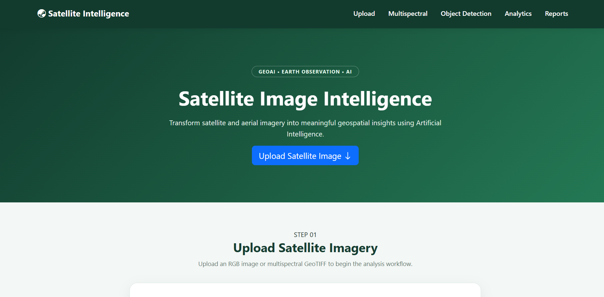
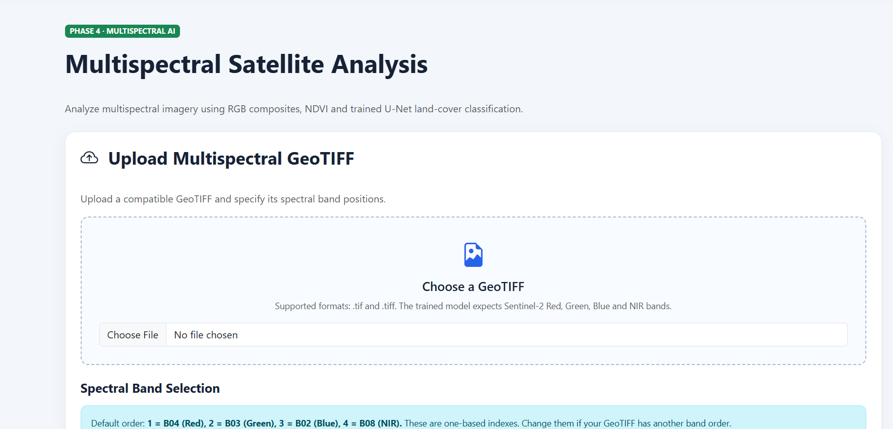
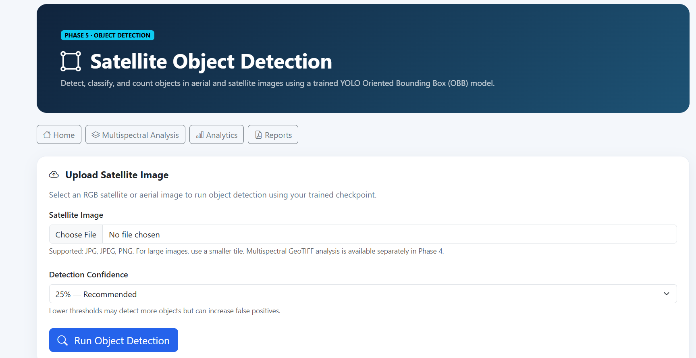
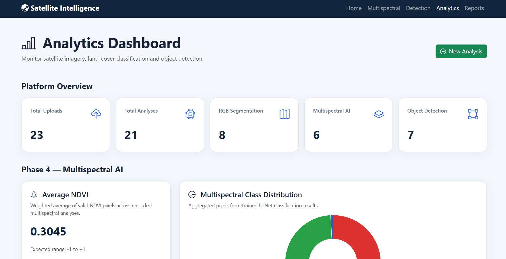
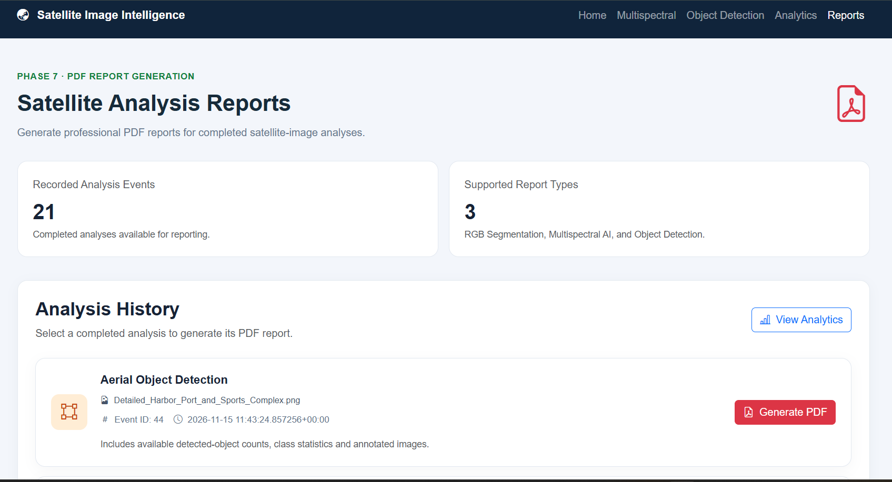

# Satellite Image Intelligence

**An AI-powered geospatial image analysis platform built with Python, Flask, PyTorch, and computer vision.**

Satellite Image Intelligence is a web-based application designed to analyze satellite and aerial imagery using artificial intelligence. It combines RGB land-cover segmentation, multispectral satellite analysis, oriented object detection, analytics, and automated PDF report generation in a unified interface.

The project is designed for geospatial image analysis, academic demonstrations, and experimentation with GeoAI technologies.

## Application Screenshots

### 1. Homepage

The homepage provides access to satellite image uploads and the application's analysis modules.



### 2. Multispectral Satellite Analysis

The multispectral module supports GeoTIFF uploads, spectral band selection, RGB composites, NDVI calculation, and compatible four-band land-cover inference.



### 3. Satellite Object Detection

The object detection module uses a trained YOLO oriented-bounding-box (OBB) model to detect, classify, and count objects in satellite and aerial images.



### 4. Analytics Dashboard

The analytics dashboard displays recorded uploads, analysis counts, NDVI statistics, land-cover class distributions, and object detection summaries.



### 5. PDF Report Generation

The reporting module generates downloadable PDF documents containing available analysis statistics and result images.



**Note:** These screenshots show the application interfaces. Model predictions and output accuracy should be assessed separately.

## Features

| Module | Functionality |
|---|---|
| RGB Land-Cover Segmentation | Upload RGB satellite imagery and generate segmentation masks, overlays, and class statistics |
| Multispectral Analysis | Inspect GeoTIFF bands, create RGB composites, calculate NDVI, and run compatible four-band land-cover inference |
| Object Detection | Detect, classify, and count objects using a trained YOLO OBB model |
| Analytics Dashboard | View recorded analysis activity, class distributions, NDVI statistics, and object counts |
| PDF Report Generation | Generate downloadable reports for completed analyses |
| Upload Validation | Validate supported formats, file sizes, and image dimensions |
| Local Processing | Execute AI inference locally using trained model checkpoints |

### RGB Segmentation Model Limitation

The RGB segmentation checkpoint produces five output channels. However, the mapping between output channel indices and semantic land-cover class names has **not yet been verified against the training metadata**.

Therefore, displayed RGB class labels should be treated as provisional. Pixel counts and percentages represent predicted channel assignments rather than independently validated land-cover ground truth.

## Technology Stack

| Category | Technologies |
|---|---|
| Programming Language | Python 3.12 |
| Backend | Flask |
| Frontend | HTML5, CSS3, JavaScript, Bootstrap, Jinja2 |
| Deep Learning | PyTorch, torchvision, segmentation-models-pytorch |
| Object Detection | Ultralytics YOLO OBB |
| Satellite Image Processing | Rasterio, NumPy, Pillow, OpenCV |
| Visualization | Matplotlib |
| Data Processing | pandas |
| PDF Generation | ReportLab |
| Development Environment | Visual Studio Code |
| Version Control | Git and GitHub |

AiTLAS and Google Earth Engine were used during earlier experimentation and training workflows. They are not assumed to be required for running the current Flask application.

## System Architecture

The application follows a modular processing workflow:

```text
                 Satellite Image Intelligence
                              |
                        Flask Web App
                              |
                       Image Upload
                              |
                    Input Validation
                              |
             +----------------+----------------+
             |                |                |
       RGB Images       Multispectral      RGB Images
                         GeoTIFFs
             |                |                |
       Land-Cover        Multispectral     YOLO OBB
       Segmentation       Processing       Detection
             |                |                |
        Masks and         RGB, NDVI,        Annotated
         Overlays        Classification      Images
             |                |                |
             +----------------+----------------+
                              |
                       Analytics Module
                              |
                      PDF Report Generator
                              |
                      Downloadable Reports
```

## Project Structure

```text
Satellite-Image-Intelligence/
|
├── app.py
├── config.py
├── requirements.txt
├── README.md
├── .gitignore
├── benchmark_segmentation.py
|
├── models/
│   ├── segmentation.py
│   ├── multispectral.py
│   ├── multispectral_inference.py
│   ├── object_detection.py
│   ├── analytics.py
│   └── report_generator.py
|
├── templates/
│   └── HTML templates
|
├── static/
│   ├── css/
│   └── js/
|
├── tests/
│   └── Automated tests
|
├── screenshots/
│   ├── homepage.png
│   ├── multispectral.png
│   ├── object_detection.png
│   ├── analytics.png
│   └── reports.png
|
├── checkpoints/
│   ├── segmentation/
│   │   └── landcover_segmentation.pth
│   ├── multispectral/
│   └── detection/
│       └── best.pt
|
├── uploads/
├── outputs/
├── previews/
└── reports/
```

**Important:** The `checkpoints`, `uploads`, `outputs`, `previews`, and `reports` directories contain local models or generated runtime files and are excluded from GitHub where configured by `.gitignore`.

The exact multispectral checkpoint filename and location must be verified in `models/multispectral_inference.py`.

## Installation and Setup

### Prerequisites

- Windows 10 or Windows 11
- Python 3.12
- Visual Studio Code or another Python-compatible editor
- Git
- Trained model checkpoints
- Sufficient available RAM and disk space for model loading and image processing

### Step 1 — Clone the Repository

```powershell
git clone https://github.com/tovintom23-max/Satellite-Image-Intelligence.git
cd Satellite-Image-Intelligence
```

### Step 2 — Create a Virtual Environment

```powershell
py -3.12 -m venv .venv
```

### Step 3 — Activate the Environment

```powershell
.\.venv\Scripts\Activate.ps1
```

### Step 4 — Install Dependencies

```powershell
python -m pip install --upgrade pip
python -m pip install -r requirements.txt
```

Dependency compatibility may vary by platform. The requirements file has not been independently verified through a completely fresh installation.

### Step 5 — Configure AI Checkpoints

Place the compatible trained checkpoints in their expected locations.

RGB segmentation:

```text
checkpoints/segmentation/landcover_segmentation.pth
```

Object detection:

```text
checkpoints/detection/best.pt
```

For multispectral inference, use the checkpoint path expected by `models/multispectral_inference.py`.

Model checkpoints are not included in the GitHub repository. The RGB model is preloaded during application startup, so a missing or incompatible checkpoint can prevent successful startup.

### Step 6 — Run the Flask Application

```powershell
python app.py
```

Open the application in your browser:

http://127.0.0.1:5000/

## Application Routes

| Route | Purpose |
|---|---|
| `/` | Homepage and RGB image upload |
| `/multispectral` | Multispectral GeoTIFF analysis |
| `/detection` | Satellite object detection |
| `/analytics` | Analytics dashboard |
| `/reports` | PDF report dashboard |
| `/health` | Application health check |

## AI Modules

### Phase 3 — RGB Land-Cover Segmentation

The RGB segmentation workflow processes supported RGB imagery through a trained segmentation model.

Outputs include a predicted segmentation mask, a colorized overlay, and per-channel pixel statistics.

The semantic meaning of the five output channels requires further validation against the original training metadata.

### Phase 4 — Multispectral Satellite Analysis

The multispectral module supports:

- GeoTIFF band inspection and validation
- True-color RGB composite generation
- Normalized Difference Vegetation Index (NDVI)
- Four-band land-cover inference using a compatible trained U-Net model

The inference workflow expects four distinct spectral bands corresponding to Red (B04), Green (B03), Blue (B02), and Near Infrared (B08).

Compatible input requirements include raw Sentinel-2 reflectance DN, an appropriate projected metric coordinate reference system, and approximately 10-meter spatial resolution. Arbitrary four-band TIFF files may not be compatible.

### Phase 5 — Satellite Object Detection

The object detection module uses a trained YOLO oriented-bounding-box model.

It supports JPEG and PNG images and produces annotated detection results, confidence values, predicted object classes, and object counts.

Detection results depend on model training, image quality, scene similarity, and the selected confidence threshold.

### Phase 6 — Analytics Dashboard

The analytics module summarizes recorded application activity and analysis results.

Available statistics include upload and analysis counts, RGB segmentation events, multispectral analyses, object detection events, NDVI summaries, and class distributions.

### Phase 7 — PDF Report Generation

The reporting module generates downloadable PDF documents for completed analyses.

Reports can include available metadata, class statistics, detection summaries, and generated visual outputs.

## Testing

Run the Python syntax check:

```powershell
python -m py_compile app.py
```

Run the automated tests:

```powershell
python -m unittest discover -s tests -v
```

**Latest recorded verification:** 21 automated tests passed.

Manual checks have also succeeded for RGB segmentation, multispectral analysis, object detection, analytics, and PDF generation.

These checks do not constitute a complete security audit or an independent scientific accuracy assessment.

## Security and Deployment

The application includes upload validation and runs with Flask debug mode disabled by default in its updated configuration.

The current Flask development server is intended for local development and demonstrations, not direct public internet exposure.

Before public deployment, additional work is required, including access control, CSRF protection, rate limiting, resource management, secure file access, and a production WSGI server.

Never commit credentials, `.env` files, private imagery, generated reports, or model checkpoints containing restricted assets.

## College Project Demonstration

The application can be demonstrated locally without purchasing cloud hosting.

Start the server using:

```powershell
python app.py
```

Then open:

http://127.0.0.1:5000/

For a smooth demonstration, use small, previously tested images and ensure all required checkpoints are present.

## Dataset and Model Licensing

The project uses AI libraries and models that may have different licensing conditions.

Verify the licenses and redistribution terms of all datasets, model checkpoints, and dependencies before publishing trained weights or using the application commercially.

In particular, review the licensing terms associated with DOTA training data and any derived model checkpoints.

## Project Status

The application currently includes working local workflows for RGB land-cover segmentation, multispectral analysis, oriented object detection, analytics, and PDF report generation.

The code and documentation are maintained in the existing GitHub repository.

Remaining improvements include verification of RGB semantic class mappings, deeper security testing, deployment configuration, and final acceptance testing.

## Repository

**GitHub:** https://github.com/tovintom23-max/Satellite-Image-Intelligence

---

**Satellite Image Intelligence — A GeoAI-based satellite imagery analysis project.**
